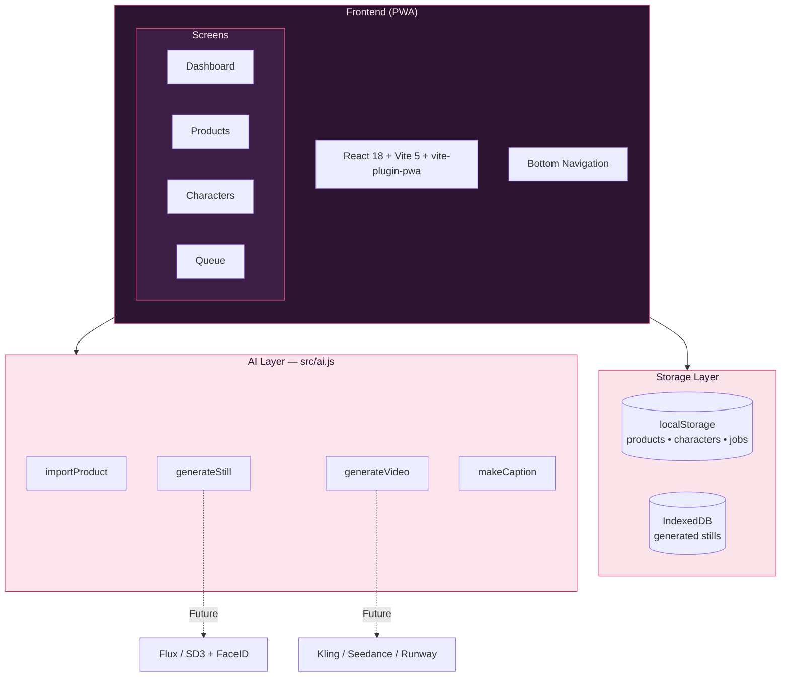

# TernoAI Studio

<p align="center">
  
</p>

<p align="center">
  <strong>Mobile-first Progressive Web App</strong> for TikTok Shop kids-fashion affiliates
</p>

<p align="center">
  
  
  
  
</p>

---

## Overview

**TernoAI Studio** helps TikTok Shop affiliates create consistent AI try-on videos for kids fashion (terno sets, dresses, etc.) with minimal effort.

### Core Purpose
Turn this daily workflow:

1. Pick a product  
2. Use the same locked AI girl model  
3. Generate still → video  
4. Export caption + media  

…into a fast, mobile-first experience.

---

## Features

| Feature                    | Description |
|---------------------------|-----------|
| **Product Library**       | Add products manually or via TikTok Shop link (stub) |
| **Character Studio**      | Create & lock up to 3 synthetic AI models |
| **Pose System**           | Twirl, Walk, Mirror try-on, Dance + custom poses |
| **Generation Queue**      | Batch queue jobs and run them one-by-one or all at once |
| **Export**                | Download still (SVG/PNG), caption (with AI label), and video |
| **Offline Support**       | App shell works offline + previously generated stills |
| **Installable PWA**       | Add to Home Screen on iOS & Android |

---

## Live Demo

**https://cat-has.github.io/TernoAI-Studio/**

---

## Screenshots

| Home | Products | Characters | Queue |
|------|----------|------------|-------|
| Dashboard with daily stats | Product importer + library | Lock consistent AI models | Generation queue + export |

---

## System Architecture

```
## System Architecture



---

## How to Use

### 1. Create & Lock a Character
- Go to **Characters** tab
- Enter name + detailed look description
- Optionally add synthetic reference image URLs
- Tap **Lock character**

### 2. Add Products
- Go to **Products** tab
- Fill in name, price, and optional photo URL
- Tap **Save product**

### 3. Queue Videos
- Select locked character + pose + number of variations
- Tap **Queue** on any product

### 4. Generate & Export
- Go to **Queue** tab
- Tap **Run** or **Run all**
- When status is `done`, tap **Export**

---

## Tech Stack

- **Frontend**: React 18 + Vite 5
- **PWA**: vite-plugin-pwa (Workbox)
- **Styling**: Pure CSS (custom design system)
- **Storage**: localStorage + IndexedDB
- **Deployment**: GitHub Pages + GitHub Actions

---

## Getting Started

### Run locally

```bash
npm install
npm run dev
```

### Build for production

```bash
npm run build
```

### Deploy to GitHub Pages

1. Push the project to a GitHub repository on the `main` branch
2. Go to **Settings → Pages → Source** and select **GitHub Actions**
3. The workflow in `.github/workflows/deploy.yml` will automatically build and publish

---

## Project Structure

```
ternoai-studio/
├── public/
│   ├── icons (72–512 + maskable)
│   ├── apple-touch-icon.png
│   ├── favicon.svg / favicon.ico
│   ├── offline.html
│   └── robots.txt
├── src/
│   ├── components/
│   │   ├── Dashboard.jsx
│   │   ├── ProductImporter.jsx
│   │   ├── ProductLibrary.jsx
│   │   ├── CharacterStudio.jsx
│   │   ├── Queue.jsx
│   │   ├── JobCard.jsx
│   │   └── BottomNav.jsx
│   ├── hooks/
│   │   ├── usePersisted.js
│   │   └── useIndexedDB.js
│   ├── utils/
│   │   ├── download.js
│   │   └── uid.js
│   ├── ai.js                 ← AI stubs (replace these)
│   ├── App.jsx
│   ├── main.jsx
│   └── styles.css
├── .github/workflows/deploy.yml
└── vite.config.js
```

---

## Replacing the AI Stubs

Open `src/ai.js`. The following functions are ready to be connected to real services:

| Function            | Purpose                                      | Recommended APIs                  |
|---------------------|----------------------------------------------|-----------------------------------|
| `importProduct`     | Fetch title, price, image from TikTok link   | Your backend / Partner API        |
| `generateStill`     | Create consistent try-on image               | Flux + FaceID / IP-Adapter        |
| `generateVideo`     | Turn still into 9:16 video                   | Kling, Seedance, Runway, Luma     |
| `makeCaption`       | Generate caption with AI label               | Optional LLM                      |

> **Important**: Never put API keys in the client. Always call your own backend or serverless function.

---

## Design System

| Token          | Value       | Usage                    |
|----------------|-------------|--------------------------|
| `--ink`        | `#2B1530`   | Text & dark surfaces     |
| `--blush`      | `#FBE3EA`   | Background               |
| `--rose`       | `#E8467C`   | Primary buttons          |
| `--mint`       | `#BFE8D4`   | Success states           |
| `--paper`      | `#FFFFFF`   | Cards                    |

---

## Important Notes

- TikTok requires AI-generated content to be clearly labeled. All exported captions include the label.
- Only use **fully synthetic** characters. Do not upload photos of real children.
- `.well-known/assetlinks.json` is prepared for a future Trusted Web Activity (Play Store).

---

## Roadmap (Future)

- [ ] Real AI image & video generation
- [ ] User accounts + cloud sync
- [ ] Batch overnight generation
- [ ] Simple analytics dashboard
- [ ] CapCut-style light editor
- [ ] Push notifications

---

## License

MIT

---

<p align="center">
  Built with ❤️ for TikTok Shop affiliates
</p>


